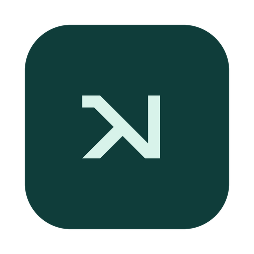
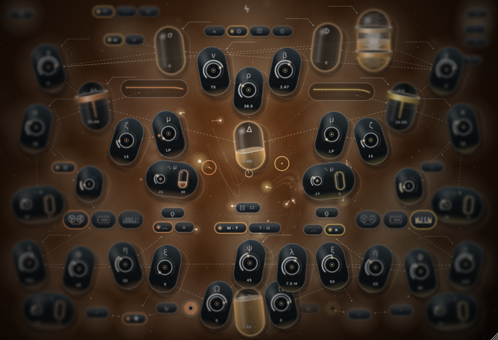
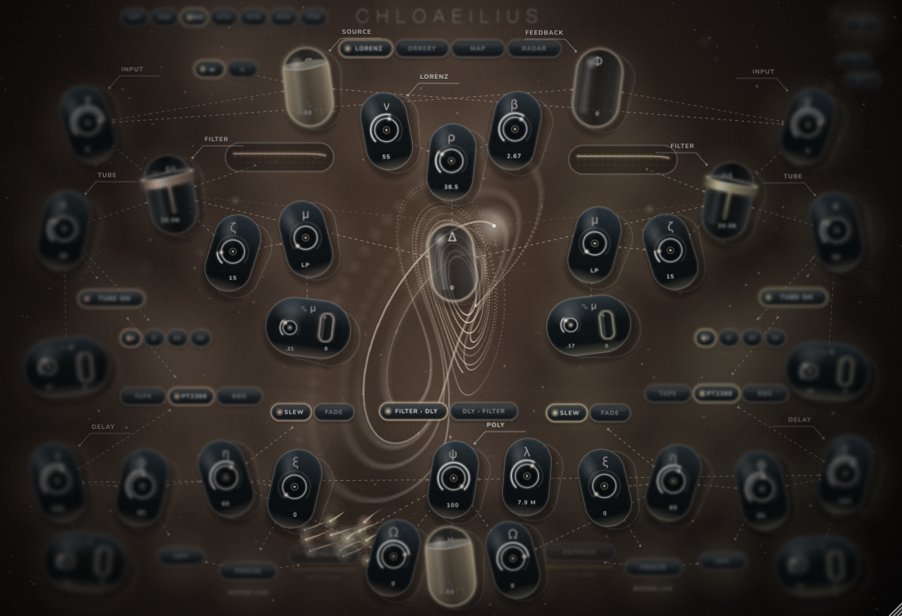
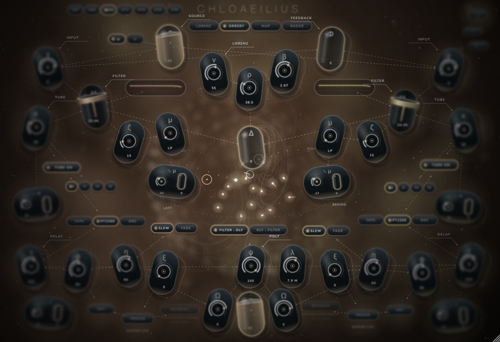
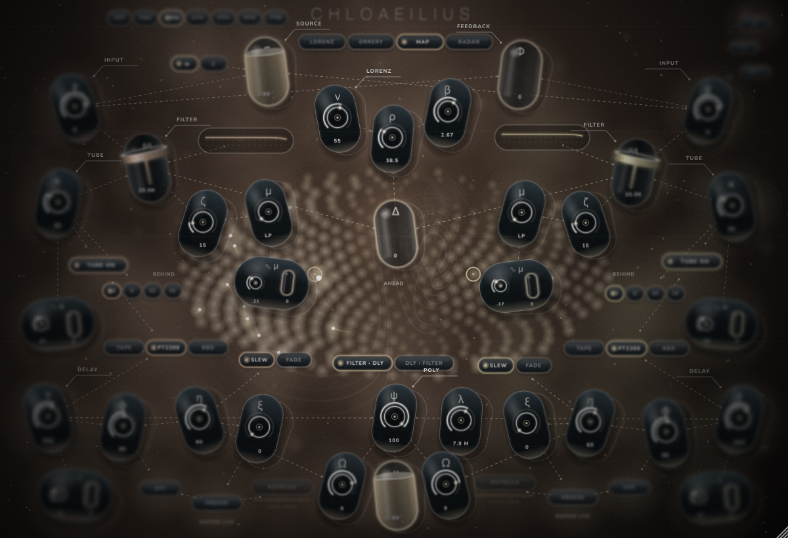
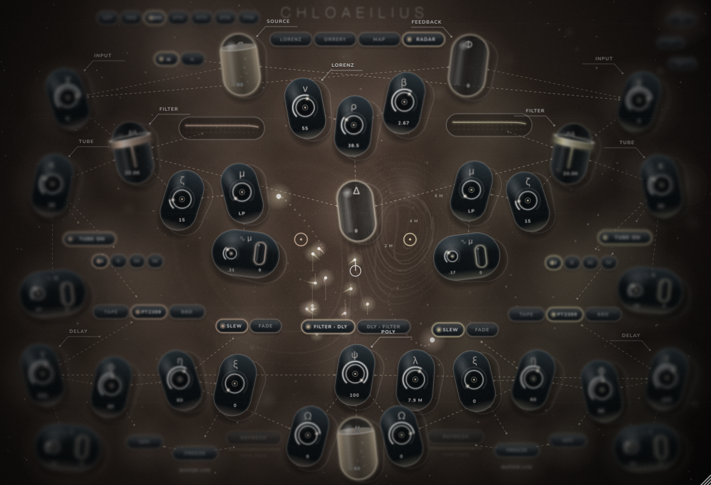
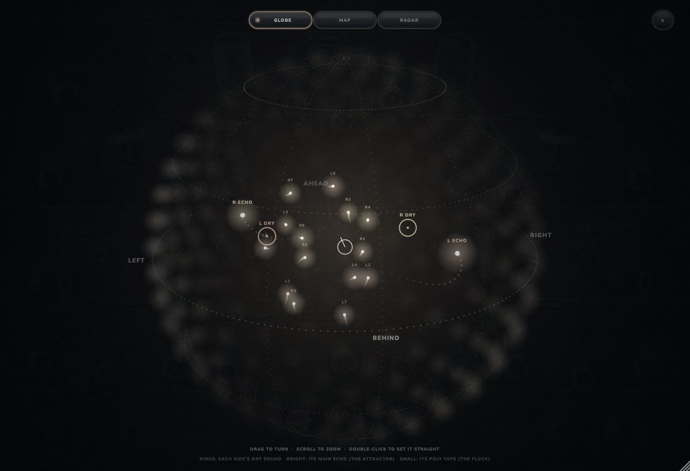
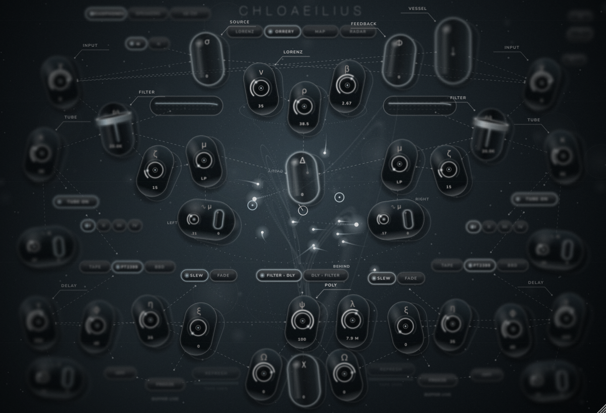

<p align="center"></p>

<h1 align="center">Chloaeilius: the spatial audio version of Chloaelis</h1>

> **Spatial audio.** Chloaeilius is the Ambisonics version (1st to 7th order, 3rd by default) of [Chloaelis](../README.md), kept in the Chloaelis repository (this folder). It is an **encoder**: stereo goes in, Ambisonics come out (ACN order, SN3D, the format of the IEM and SPARTA plug-ins: 16 channels at 3rd order, 36 at 5th, 64 at 7th), and it decodes nothing itself. Route all of them to a decoder of the same order. For the ordinary stereo instrument, see [Chloaelis](../README.md).

<p align="center">
The same dual filter, tube and delay instrument,<br>
with its echoes flying round you on the flock and the Lorenz attractor.<br>
<i>Inspired by the 2012 game <b>Splice</b> and the <b>Chloe</b> Eurorack module by Bizarre Jezabel.</i>
</p>



**[The manual (PDF)](docs/manual/Chloaeilius%20Manual.pdf)**: the sphere, the desktop app, Chloaelis's controls, every parameter and answers to common problems.

---

## The sphere

Chloaeilius is an encoder. It sends Ambisonics (ACN order, SN3D, the format of the IEM and SPARTA plug-ins) and decodes nothing itself. The **order** switch at the top left picks how sharp it is, from 1st to 7th order: 3rd (the default) is 16 channels, 5th is 36, 7th is 64. In REAPER, give the track that many channels and put the IEM AllRADecoder (loudspeakers) or BinauralDecoder (headphones) after it at the same order, SN3D. On a track with too few channels for the order you picked, the highest order that fits comes out. At 7th order all 18 points take about 14 % of one core, against 10 % at 3rd.

Where the sound goes:

- Each side's **dry sound** is a point: the left side ahead and to the left, the right side ahead and to the right.
- Each side's **main echo** rides the Lorenz attractor (the right side's mirrored through you), so the delay's repeats loop round you in the butterfly's figure.
- Each of the **seven poly taps** per side rides one bird of the flock, now flying in three dimensions round you. A feedback trail comes back from wherever its bird has flown, so repeats drift through the room, and the birds gather and scatter round you rather than to one side.
- **Distance**, after the IEM RoomEncoder: every point has its own propagation delay (so echoes flying towards you or away bend in pitch), 1/r level, a little air absorption and first-order reflections from the walls of a room round you. The **Distance** knob (lambda) is the size of the bubble you're in, from 1.5 m to 24 m: in a small bubble everything is close and loud and the room answers quickly; in a big one everything is far, quieter, later and roomier.
- With the order on *delay > filter*, the dry sound goes through the tube and filter as before and each tap through its own filter (the taps skip the tube there, so they stay apart).

**Space View**, the switch under the title, shows the sphere four ways (the sound is the same in all of them):

| | |
| --- | --- |
| **Lorenz**: the attractor alone, as in Chloaelis |  |
| **Orrery**: a dotted globe round you, turning slowly and leaning with the cursor; every point flies inside it with its trail, and the loud places glow on its skin |  |
| **Map**: the whole sphere unrolled (a Hammer projection, as the IEM EnergyVisualizer), ahead in the middle, behind at both edges, with the energy as glowing dust |  |
| **Radar**: from above, rings in metres out to the bubble's edge, each point on a stalk as tall as it is high, and a ripple wherever an echo lands |  |

**The sphere button** (the circle under **?** in the top right) opens a big sphere over the whole window, with nothing in the way: drag to turn it, scroll to zoom, double-click to set it straight, and switch between globe, map and radar along the top. Every point is named (L DRY, L ECHO, L1 to L7 for the taps, and the same for R), and the loud places glow on the glass.



## The desktop app

`Chloaeilius.app` (`Chloaeilius.exe` on Windows, `Chloaeilius` on Linux) is Chloaeilius on its own, with no DAW, and it has Chloaelis's desktop extras:

- **The vessel** (top right): load your own sample. Drop an audio file onto it (WAV, AIFF, FLAC, MP3, M4A, OGG or CAF, up to 10 minutes) or double-click it to choose one. The two rings set the loop, and dragging the glass sets its level. It plays into both sides and its echoes fly round you like everything else.
- **Listen** (top left), because without a DAW there's nowhere to put a decoder:
  - **Headphones**: the sphere decoded to binaural (a spherical-head model), on outputs 1 and 2.
  - **Speakers**: a stereo decode for two loudspeakers.
  - **16 ch**: the Ambisonics themselves, for a multichannel interface or to route into another app (for example through BlackHole into REAPER and an IEM decoder).
- **Options** (the audio device and channels), **fullscreen** (cmd+F, esc to leave) and the help, as in Chloaelis.

The plug-ins (AU, VST3, LV2) have no Listen switch: in a DAW they always send the Ambisonics to your decoder. The desktop app works at 3rd order.



## Build it

Chloaeilius isn't released as a download yet. When it is, its releases will be tagged `chloaeilius-v...` on the [Chloaelis Releases page](https://github.com/femifleming/Chloaelis/releases), separate from Chloaelis's own. For now, build it from this folder (it shares the repository's JUCE, fonts and recordings, so clone the whole thing):

```sh
git clone --recursive https://github.com/femifleming/Chloaelis.git
cd Chloaelis
cmake -S Chloaeilius -B build-chloaeilius -DCMAKE_BUILD_TYPE=Release -DCHLOAEILIUS_COPY_AFTER_BUILD=ON
cmake --build build-chloaeilius --config Release --target Chloaeilius_All
```

It appears in your DAW as **Chloaeilius** under **Chloaelis**. The tests are `ChloaeiliusTest`, `ChloaeiliusSpatialTest` (where the sound lands, every channel against AmbiX, CPU) and `ChloaeiliusHostTest` (`SPACE_SHOTS=<folder>` saves every view of the sphere).

Everything else (the controls, the delay engines, the tube, the help) works as in Chloaelis: see [its README](../README.md#how-to-use-it).


## Human contributions

Chloaeilius was written with Claude Code (Anthropic) under the direction of its author, [femifleming](https://github.com/femifleming). It is the spatial version of Chloaelis. The idea, the references (Bizarre Jezabel's *Chloe* and the game *Splice*), the look and the field recordings all come from the author's work on Chloaelis: see [Human contributions](../README.md#human-contributions) in its README.
