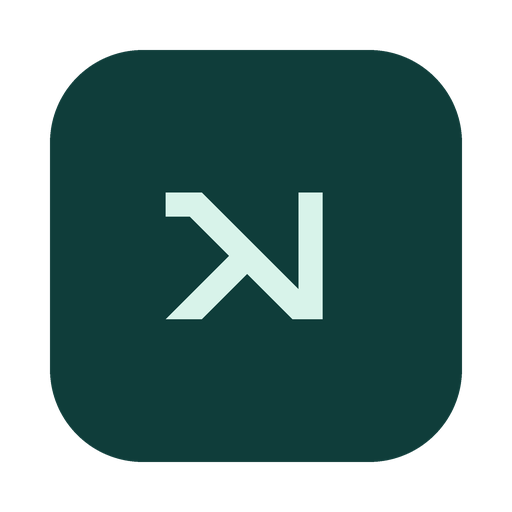
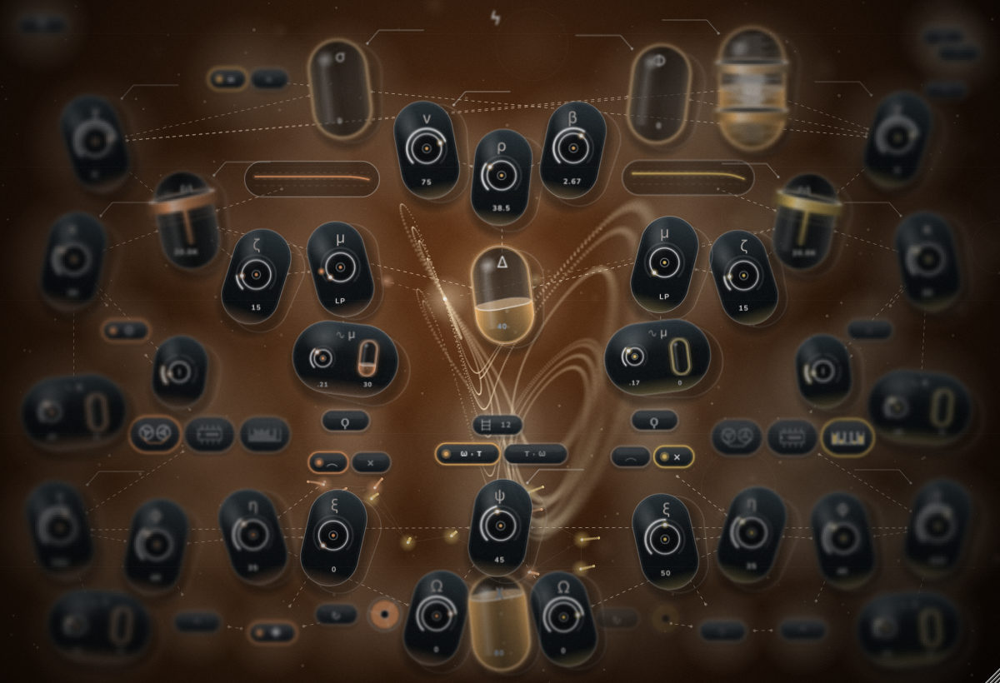
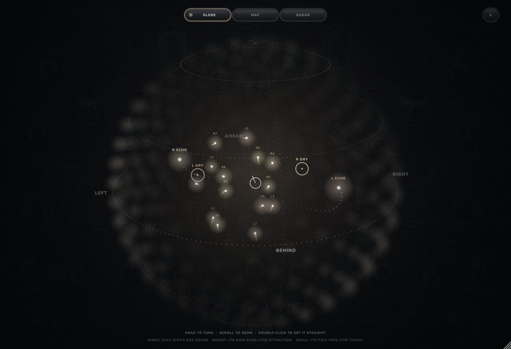
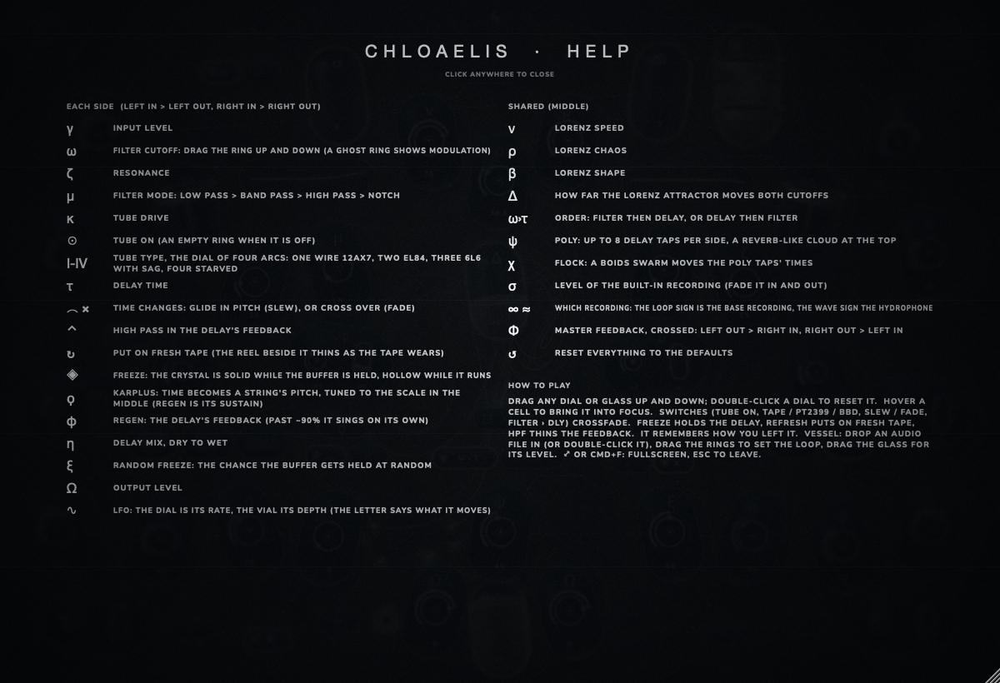

<p align="center"></p>

<h1 align="center">Chloaelis</h1>

<p align="center">
A dual-channel filter, tube and delay instrument with a Lorenz attractor, a flock of boids,<br>
and two field recordings built in. Plug-in (AU / VST3 / LV2) and desktop app, for macOS, Windows and Linux.<br>
<i>Inspired by the 2012 game <b>Splice</b> and the <b>Chloe</b> Eurorack module by Bizarre Jezabel.</i>
</p>



> **Spatial audio version: [Chloaeilius](Chloaeilius/README.md).** Chloaelis as an Ambisonics encoder (1st to 7th order, 16 channels at 3rd order up to 64 at 7th, ACN/SN3D, for the IEM and SPARTA decoders): each side's dry sound is a point, its main echo rides the Lorenz attractor and its poly taps ride a 3-D flock, so the echoes fly round you, with distance and Doppler and a sphere you can turn to see where everything is. It lives in the [`Chloaeilius`](Chloaeilius) folder of this repository.
>
> 

---

## Contents

- [What it is](#what-it-is)
- [Download and install](#download-and-install)
  - [macOS (Homebrew)](#macos-homebrew)
  - [macOS (manual)](#macos-manual)
  - [Windows](#windows)
  - [Linux](#linux)
- [How to use it](#how-to-use-it)
  - [The layout](#the-layout)
  - [The symbols](#the-symbols)
  - [Playing it](#playing-it)
  - [The desktop app](#the-desktop-app)
  - [Help inside the app](#help-inside-the-app)
- [Build from source](#build-from-source)
- [Human contributions](#human-contributions)
- [Credits and licence](#credits-and-licence)

**[The manual (PDF)](docs/manual/Chloaelis%20Manual.pdf)**: everything here plus a reference for every parameter and answers to common problems.

---

## What it is

Chloaelis is two complete signal paths, hard-panned: the **left input goes through the left
side to the left output**, and the right through the right. Each side runs

**input > multimode filter > tube > delay > output**

(or delay > tube > filter, with the order switch). Shared controls in the middle tie the two
sides together:

- **Filter**: continuous low pass > band pass > high pass > notch, with resonance.
- **Tube**: four types, each oversampled 4x: I 12AX7 (the default: warm, two triode stages),
  II EL84 (push-pull pentodes, crunchy), III 6L6 (with power-supply sag, it blooms) and
  IV starved (a low-voltage 12AX7, gated and sputtery).
- **Delay engines**: *tape* (an ageing tape loop: hiss, wow and flutter, oxide wear; it ages
  while it runs and *refresh* puts on new tape), *PT2399* (the delay chip, gritty at long times)
  and *BBD* (bucket brigade, dark and crunchy). Up to 1 s, regen that self-oscillates, a
  feedback high-pass, freeze, random freeze, and slew (pitch-bending) or fade time changes.
- **Poly**: fades in up to 8 delay taps per side at irregular offsets. All the way up it
  becomes a reverb-like cloud. **Flock** lets a boids simulation move those taps' times, so
  they drift, cluster and scatter.
- **Lorenz attractor**: its x and y move the left and right cutoffs.
- **LFOs**: triangle LFOs on filter mode, delay time and tube drive, per side.
- **Master feedback**, crossed over: the left output feeds the right input and the right
  output the left.
- **Two built-in recordings** to play through it: a long loop from *baserecording1* and a
  hydrophone recording. Fade them in and out; the left channel goes to the left side and the
  right to the right.
- Every switch (order, delay engine, time mode, tube type) **crossfades**: echoes ring out
  in the old setting while new sound goes through the new one, so there are no cuts.
- It **remembers** how you left it, and **↺** resets everything.

---

## Download and install

Ready-made builds for all three systems are on the
**[Releases page](https://github.com/femifleming/Chloaelis/releases/latest)**:

| System  | File                      | Contains                                        |
|---------|---------------------------|-------------------------------------------------|
| macOS   | `Chloaelis-macOS.zip`     | the app, the Audio Unit and the VST3 (Intel + Apple Silicon) |
| Windows | `Chloaelis-Windows.zip`   | the app (`Chloaelis.exe`) and the VST3          |
| Linux   | `Chloaelis-Linux.tar.gz`  | the app, the VST3 and the LV2                   |

`SHA256SUMS.txt` on the same page lists checksums if you want to verify a download.

> The builds aren't signed by Apple or Microsoft (that costs money), so the first launch
> needs one extra step on macOS and Windows. It's described below.

### macOS (Homebrew)

If you use [Homebrew](https://brew.sh):

```sh
brew install --cask femifleming/chloaelis/chloaelis
```

This installs the app into `/Applications` and the Audio Unit and VST3 into
`~/Library/Audio/Plug-Ins`. To update later: `brew upgrade --cask chloaelis`. To remove:
`brew uninstall --cask chloaelis`.

### macOS (manual)

1. Download `Chloaelis-macOS.zip` from the
   [Releases page](https://github.com/femifleming/Chloaelis/releases/latest) and unzip it.
2. Drag **Chloaelis.app** into **Applications**.
3. For the plug-ins, open Finder, press **⇧⌘G** and go to `~/Library/Audio/Plug-Ins`. Copy
   **Chloaelis.component** into the `Components` folder and **Chloaelis.vst3** into `VST3`
   (create either folder if it's missing).
4. First launch: because the build isn't notarised, macOS will refuse to open it the first
   time. Either right-click the app and choose **Open**, then **Open** again, or run this once
   in Terminal:
   ```sh
   xattr -dr com.apple.quarantine /Applications/Chloaelis.app ~/Library/Audio/Plug-Ins/Components/Chloaelis.component ~/Library/Audio/Plug-Ins/VST3/Chloaelis.vst3
   ```
5. Restart your DAW (Logic, Ableton Live, Reaper and so on) so it rescans its plug-ins.
   Chloaelis appears under the maker **Chloaelis**.

### Windows

1. Download `Chloaelis-Windows.zip` and unzip it.
2. **App**: put `Chloaelis.exe` anywhere and double-click it. If SmartScreen says
   "Windows protected your PC", click **More info** > **Run anyway** (it only asks once).
3. **Plug-in**: copy the `Chloaelis.vst3` folder into `C:\Program Files\Common Files\VST3`.
4. Restart your DAW so it rescans.

### Linux

1. Download `Chloaelis-Linux.tar.gz` and unpack it:
   ```sh
   tar -xzf Chloaelis-Linux.tar.gz
   ```
2. **App**: run `./Chloaelis/Chloaelis` (you may want to copy it to `~/.local/bin`).
3. **Plug-ins**:
   ```sh
   mkdir -p ~/.vst3 ~/.lv2
   cp -r Chloaelis/Chloaelis.vst3 ~/.vst3/
   cp -r Chloaelis/Chloaelis.lv2  ~/.lv2/
   ```
4. It needs ALSA or JACK, X11 and OpenGL, which a normal desktop already has.

---

## How to use it

### The layout



- The **left half** of the window is the left channel and the **right half** is the right
  channel. They mirror each other: input at the top, then filter, tube and LFOs, delay at the
  bottom, output at the bottom middle.
- The **middle** holds the shared controls: the Lorenz attractor (top), the poly and flock
  (bottom), the order switch, and the built-in recordings, master feedback and the vessel
  (top row).
- **Glowing dashed lines** show where signal and modulation flow. Pulses of light follow the
  signal.
- Cells **glow with level**: the side's colour when it's moving, warm white when it's hot and
  red when it's close to clipping.
- The **Lorenz attractor** floats in the background as a hologram, with dashed lines to the
  two cutoffs. The **boids** of the flock fly around the poly controls.

### The symbols

Every control is named by a Greek letter. Press **?** (top right) for this list inside the app.

**Each side**

| Symbol | Control | What it does |
|:-:|---|---|
| γ | Input | input level |
| ω | Cutoff | filter cutoff: drag the ring up and down. A faint ring shows where modulation has pushed it |
| ζ | Resonance | filter resonance |
| μ | Mode | filter mode: low pass > band pass > high pass > notch, continuously |
| κ | Drive | tube drive |
| I–IV | Tube type | I 12AX7 (default), II EL84, III 6L6 with sag, IV starved |
| TUBE ON | | switches the tube in and out |
| τ | Time | delay time, 30 ms to 1 s |
| φ | Regen | the delay's feedback. Past about 90% it sings on its own |
| η | Mix | delay dry / wet |
| ξ | Random freeze | the chance that the delay buffer gets held for a while at random moments |
| TAPE / PT2399 / BBD | | the delay engine |
| SLEW / FADE | | time changes either glide (pitch bends) or crossfade (no pitch change) |
| HPF | | high-pass filter in the delay feedback |
| FREEZE | | holds the delay buffer. On tape, a held loop slowly wears away |
| REFRESH | | puts on fresh tape (tape engine only) |
| Ω | Out | output level |
| ∿ | LFO | the dial is its rate, the small glass vial its depth. The letter next to ∿ says what it moves (μ mode, τ time, κ drive) |

**Shared (middle)**

| Symbol | Control | What it does |
|:-:|---|---|
| ν | Speed | how fast the Lorenz attractor moves |
| ρ | Chaos | the attractor's rho: low wanders gently, high is wild |
| β | Shape | the attractor's beta: reshapes the orbit |
| Δ | Depth | how far the attractor moves the two cutoffs (up to ±3.5 octaves) |
| FILTER › DLY / DLY › FILTER | Order | filter > tube > delay, or delay > tube > filter |
| ψ | Poly | up to 8 delay taps per side. All the way up is a reverb-like cloud |
| χ | Flock | how much the boids move the poly taps' times (up to about ±0.9 octave) |
| ∞ / ≈ | Source | which built-in recording: ∞ the base loop, ≈ the hydrophone |
| σ | Source level | fades the built-in recording in and out |
| Φ | Master feedback | crossed: left out > right in, right out > left in |
| ↺ | Reset | every control back to its default (the tape's wear is kept) |
| ? | Help | the key to all of this, inside the app |

### Playing it

- **Drag up and down** on any dial, glass vial or ring to change it. **Double-click** a dial to
  reset it to its default.
- **Hover** over a control to bring it into focus. The depth of field follows you, and the
  field tilts slightly toward the cursor.
- **No input?** Turn up **σ** to play one of the built-in recordings through it, and pick
  which with **∞ / ≈**.
- **Ideas to start with**
  - *Ambient wash*: σ up, ψ (poly) and χ (flock) up, φ (regen) around 60%, tape engine.
  - *Lo-fi echo*: PT2399 or BBD, τ around 400 ms, φ around 70%, κ (drive) up a little.
  - *Moving filter*: Δ (Lorenz depth) up, ρ (chaos) up, ζ (resonance) up.
  - *Self-playing*: Φ (master feedback) towards 90% with some regen: the two sides feed each
    other and keep going on their own.
- Chloaelis **remembers its last state**: a new instance starts how the last one was closed.
  In a DAW, the project's own saved settings take priority.

### The desktop app

The app (`Chloaelis.app`, `Chloaelis.exe` or `Chloaelis` on Linux) has a few extras:

- **Audio settings**: the **Options** button at the top left of the window chooses the
  audio device, the input and output channels and the buffer size.
- **Fullscreen**: the **⤢** button, or **⌘F** (Ctrl+F on Windows and Linux). It fills the
  whole screen with no menu bar or title bar, at any screen shape. **Esc** leaves it.
- **The vessel** (top right): a glass you can pour your own audio into.
  - **Drop an audio file** onto it (WAV, AIFF, FLAC, MP3, M4A, OGG or CAF, up to 10 minutes),
    or **double-click** it to choose one.
  - Its waveform runs up the inside, start at the bottom.
  - The **two rings** are the loop start and end: drag them.
  - **Drag the glass** itself (away from the rings) to set its level, shown by the liquid.
  - It plays into both sides like the built-in recordings, and is remembered with the rest
    of the state.

### Help inside the app

Press **?** (top right) for a full key to the symbols and a short how-to. Click anywhere,
or press Esc in the app, to close it.

---

## Build from source

You need CMake 3.22 or newer and a C++20 compiler (Xcode on macOS, Visual Studio 2022 on
Windows, GCC or Clang on Linux).

```sh
git clone --recursive https://github.com/femifleming/Chloaelis.git
cd Chloaelis
cmake -B build -DCMAKE_BUILD_TYPE=Release
cmake --build build --config Release --target Chloaelis_All
```

The results are in `build/Chloaelis_artefacts/Release/` (`Standalone`, `VST3`, plus `AU` on
macOS and `LV2` on Linux). Add `-DCHLOAELIS_COPY_AFTER_BUILD=ON` to have the plug-ins copied
into your user plug-in folders after each build.

On Linux, install the development packages first (Debian / Ubuntu names):

```sh
sudo apt-get install libasound2-dev libjack-jackd2-dev libfreetype-dev libfontconfig1-dev \
  libx11-dev libxcomposite-dev libxcursor-dev libxext-dev libxinerama-dev libxrandr-dev \
  libxrender-dev libxi-dev libegl-dev libgl1-mesa-dev libglu1-mesa-dev mesa-common-dev ladspa-sdk
```

If you cloned without `--recursive`, run `git submodule update --init` to fetch JUCE.

Tests (macOS): `cmake -B build -DCHLOAELIS_BUILD_TESTS=ON` builds `ChloaelisTest` (offline
DSP checks) and `ChloaelisHostTest` (the full plug-in, headless; `CHL_AUDIOTEST=1` runs the
audio checks).

---

## Human contributions

Chloaelis's code was written with Claude Code (Anthropic), working under the direction of its author, [femifleming](https://github.com/femifleming). This is what the author brought to it:

- **The concept and the signal path.** Two of Bizarre Jezabel's *Chloe* Eurorack modules, hard-panned left and right, each running filter > tube distortion > PT2399 delay. Includes a buffer freeze, with the PT2399's artefacts kept in.
- **The name.** Chloaelis was its own plug-in from the start, separate from the author's other plug-ins.
- **The three delay engines and their sound references.** Tape, PT2399 and BBD. The tape has hiss, about 2 % warble, wear that builds as it runs and a refresh button, after clippingrainbirds.world, William Basinski, Ian William Craig and Amulets. The BBD is crunchy, like the Serge delay.
- **The modulation ideas.**
  - A Lorenz attractor with one output to each cutoff.
  - Random freeze.
  - Slew vs fade time changes.
  - A delay/filter order switch.
  - Poly taps: offset copies, up to 8 per side.
  - A boids "flock" knob for tap chaos.
  - Crossed master feedback.
- **What was cut.** The vactrol/LPG/VCA section, the per-parameter LFOs, the VU meters (colour shows level instead), the black pop-ups and the background text. Tube types came back with the original as the default, and every switch crossfades instead of cutting.
- **The visual direction.** It comes from the 2012 game *Splice*: a network of cells, dark glow, grain, bokeh and a tilt-shift focus that follows the cursor. The author toned the perspective down several times and turned down other looks along the way.
- **Interface details.**
  - HUD dials with one thin continuous ring.
  - Glass capsule cells.
  - Greek-letter labels instead of text.
  - Glass vials only for depth, and sliding collars for the cutoffs.
  - Colour that opens cool and grey and warms with the input.
  - A plain gradient icon.
- **The built-in recordings.** Two of the author's own field recordings ship in the plug-in: a base recording and a hydrophone recording.
- **The desktop app.** The drag-in sample vessel, true fullscreen on Cmd+F, remembering the last state, and a reset button.
- **Testing.** The author reported lag (and set a 30 fps minimum), pixelation, aliasing in the blur, stepped focus and hover jitter, and had them fixed.
- **The release.** Builds for macOS, Windows and Linux, a README, in-app help and a Homebrew install, with credit to *Splice* and *Chloe*.

## Credits and licence

- Design and recordings: **Femi Fleming**. The two built-in recordings are Femi Fleming's
  field recordings (*baserecording1* and *hydrophone, June 2026, 3*).
- Inspired by the 2012 game *Splice* and the *Chloe* Eurorack module by Bizarre Jezabel.
- Built with [JUCE](https://juce.com) 9.0.5, used under the GNU AGPLv3.
- Interface font: [Nunito](https://github.com/googlefonts/nunito) (a bold cut), SIL Open
  Font License 1.1 (see `Resources/fonts/OFL-Nunito.txt`).

Chloaelis is free software: you can redistribute it and/or modify it under the terms of the
**GNU Affero General Public License v3** as published by the Free Software Foundation. See
[LICENSE](LICENSE).
